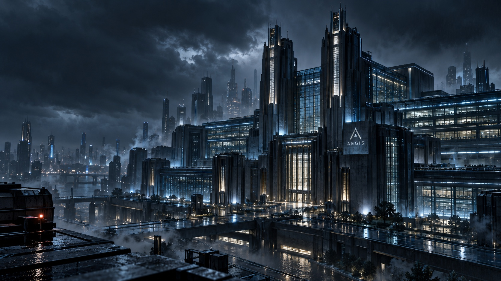
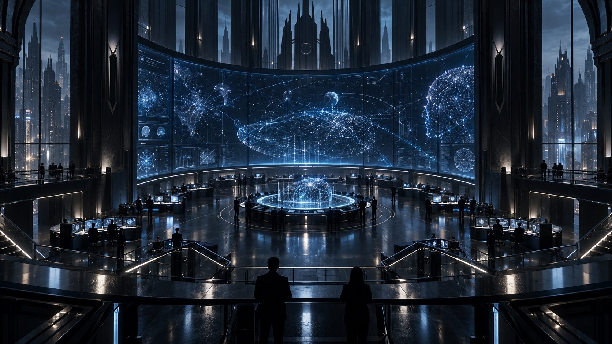

<div align="center">

# A E G I S
### Intelligence for an uncertain world.

**PROJECT SENTINEL · REINFORCEMENT LEARNING**

Unity ML-Agents · Proximal Policy Optimization (PPO) · TensorBoard

[**Explore AEGIS ↗**](https://aegis-sentinel-6u5m.onrender.com/) &nbsp; · &nbsp; [**Enter Sentinel Command ↗**](https://aegis-sentinel-6u5m.onrender.com/#command) &nbsp; · &nbsp; [**The Unity project ↗**](https://github.com/dane-anderson/days_gone_quiet)

<a href="https://aegis-sentinel-6u5m.onrender.com/">
  
</a>

*Advanced autonomous systems. Decisions under uncertainty.*

</div>

---

## The future will not think with one mind.

**Intelligence must learn to operate in a world it cannot fully predict.**

AEGIS Dynamics explores autonomous learning, distributed intelligence, and adaptation. **Project Sentinel** is its flagship **reinforcement learning** research initiative: an investigation into how independent learning agents might become more capable together.

The first experimental world is [**Days Gone Quiet**](https://github.com/dane-anderson/days_gone_quiet). Within its Unity environment, two independent policies are trained with **Proximal Policy Optimization (PPO)** through **Unity ML-Agents**. Rick learns escape behavior; Negan learns simulated combat. Agents learn through observations, actions, and rewards, with training signals recorded in **TensorBoard**. Two policies. Separate objectives. A shared world that pushes back.

Sentinel Command brings the records into view. Athena, Chief Intelligence Officer, gives the fictional organization its executive presence. Her mandate: challenge assumptions, examine evidence, and ask the question everyone else missed.

```text
AEGIS DYNAMICS
└── PROJECT SENTINEL                 Research initiative
    ├── SENTINEL COMMAND             Research headquarters
    └── DAYS GONE QUIET              Experimental environment 001
```

## A transmission from Athena

> **“Days Gone Quiet is only the beginning.”**

Meet AEGIS's fictional Chief Intelligence Officer. A ten-second transmission from the executive office, created with Runway.

https://github.com/user-attachments/assets/67c82771-ed6d-4ea9-8632-5fc92452f115

[**Enter Athena’s office ↗**](https://aegis-sentinel-6u5m.onrender.com/#briefing) &nbsp; · &nbsp; [**Download the transmission ↓**](https://aegis-sentinel-6u5m.onrender.com/assets/athena-transmission.mp4)

*AI-generated character performance and voice. The defense-intelligence mission is part of the AEGIS fiction; the reinforcement learning experiments and recorded evidence are described below.*

## Step inside

| Destination | What you can explore |
| :--- | :--- |
| [**AEGIS headquarters**](https://aegis-sentinel-6u5m.onrender.com/) | The organization, its mission, and its research mandate. |
| [**Sentinel Command**](https://aegis-sentinel-6u5m.onrender.com/#command) | A research dashboard with recorded training signals, experiment records, and source evidence. |
| [**Training records**](https://aegis-sentinel-6u5m.onrender.com/#runs) | Run and policy selectors, original reward curves, accessible tables, and a downloadable snapshot. |
| [**Athena's office**](https://aegis-sentinel-6u5m.onrender.com/#briefing) | A cinematic mission transmission with replay, a curated executive briefing, and a browser-local research notebook. |
| [**Research roadmap**](https://aegis-sentinel-6u5m.onrender.com/#roadmap) | The path toward controlled evaluation, cooperation, and a connected research workspace. |

<a href="https://aegis-sentinel-6u5m.onrender.com/#command">
  
</a>

*Sentinel Command facility concept. The dashboard presents recorded research data; this image is not live telemetry.*

## Evidence before claims

The public dashboard contains a **curated snapshot exported October 9, 2026**:

| Selected run | Rick checkpoint | Negan checkpoint | Reward samples, both policies |
| :--- | ---: | ---: | ---: |
| `prison-duo-v2` | 108,541 steps | 108,541 steps | 434 |
| `barn-team-v2` | 2,264 steps | 2,264 steps | 8 |
| `prison-duo-v1` | 124,307 steps | 124,307 steps | 496 |
| **Snapshot total** | **3 runs** | **6 policy records** | **938 samples** |

Every chart uses original `Environment/Cumulative Reward` scalars without smoothing. The source manifest includes SHA-256 hashes, and the [research JSON](public/data/research.json) is available to inspect.

> **A recorded reward is a training signal, not a success rate.** Rick and Negan have different reward functions. Reliable escape, combat performance, cooperative improvement, and transfer between environments still need controlled evaluation.

## Available now / next to build

| Available now | Planned |
| :--- | :--- |
| Public cinematic website, responsive on desktop and phone | Server-side authenticated private workspace |
| Recorded training curves, evidence manifest, snapshot download | Automated experiment ingestion and a research database |
| Hypotheses and research roadmap | Repeated-seed evaluation, cooperation, and transfer experiments |
| Athena's recorded transmission, curated brief, and browser-local notebook | Source-grounded AI conversation, research memory, and voice |

The dashboard is public and its live feed is disconnected. Notebook entries stay in the current browser unless you download them. Athena is a fictional executive; her transmission is a prerecorded, AI-generated character video, and no live AI model or interactive voice service is connected. The video plays once on entering her office when browser settings allow, has native playback controls and a replay button, and pauses when you leave. Reduced-motion preferences disable automatic playback. The original MP4 is hosted with the site so playback does not depend on an expiring media link.

## Built to grow

```text
Days Gone Quiet                         AEGIS / Project Sentinel
Unity + ML-Agents                       Public site + Sentinel Command
        │                                          ▲
        └── local training records ── reviewed JSON ┘
                 TensorBoard          manual export
```

**HTML · CSS · JavaScript · Render** — a static site with no application build step. Unity training stays in its own repository and environment.

## Run locally

```sh
git clone https://github.com/dane-anderson/aegis-sentinel.git
cd aegis-sentinel
python3 -m http.server 4173 --bind 127.0.0.1 --directory public
```

Open http://127.0.0.1:4173. Use an HTTP server: opening the HTML file directly will not load the research JSON.

No application dependencies or build are required. Fonts are served by Google Fonts, with local system-font fallbacks.

<details>
<summary><strong>Render deployment</strong></summary>

The live site is [aegis-sentinel-6u5m.onrender.com](https://aegis-sentinel-6u5m.onrender.com/), deployed from this repository's `main` branch.

For another deployment, create a **Static Site**, use the `main` branch, set build command to `echo 'Static assets ready'`, and publish directory to `public`. [render.yaml](render.yaml) records the static-site configuration and optional response headers. Account usage limits apply; no custom domain is required.

</details>

<details>
<summary><strong>Data provenance and refreshing the snapshot</strong></summary>

`public/data/research.json` contains the selected snapshot. It was exported read-only from local ML-Agents output on October 9, 2026. The original Unity repository and training output were not edited by this web project.

The three selected runs are `prison-duo-v2`, `barn-team-v2`, and `prison-duo-v1`. Exported sources include training status, run configuration, and TensorBoard scalar files. SHA-256 hashes record each source file. Machine-specific event filenames are redacted from the public manifest. Model weights, absolute filesystem paths, and research notebook contents are not published.

The public Unity source revision is context; local work includes changes that have not been committed. Exact environment revisions and evaluation seeds were not recorded for these runs. Environment names are descriptive run labels. A saved checkpoint below its step target does not establish why training ended, and no current process state is inferred.

The chart shows every retained `Environment/Cumulative Reward` scalar without smoothing. Checkpoint summary reward is a different record and may not equal the last TensorBoard scalar. Rick and Negan use different reward functions. Reward is not a success percentage or proof of cooperation, reliable task performance, or transfer.

To refresh using a Python environment with TensorBoard and PyYAML installed:

```sh
python scripts/export_research.py --results /path/to/results --output public/data/research.json
```

Review the selected runs and snapshot before publishing. The exporter only reads existing records; it does not start, stop, resume, or modify training. Refreshing is a manual action, not an installed automation.

</details>

<details>
<summary><strong>Repository map and validation</strong></summary>

```text
public/
  index.html             Public site and command workspace
  styles.css             Responsive visual design
  app.js                 Navigation, charts, evidence, and notebook
  assets/                Headquarters, command theater, and character art
  data/research.json     Reviewed training snapshot and source manifest
scripts/
  export_research.py     Read-only exporter for existing training records
  check_site.py          Static-asset and research-snapshot checks
render.yaml              Render static-site configuration
IMAGE-PROMPTS.txt         Image prompts and generation method
```

Check the static package and snapshot:

```sh
python3 scripts/check_site.py
```

</details>

## Art and identity

The AEGIS headquarters, Sentinel Command theater, and Athena portrait are original AI-generated concept assets. See the [image prompts and generation method](IMAGE-PROMPTS.txt). The Days Gone Quiet artwork is environment concept art from the Unity project, not a capture of a running scene.

AEGIS is a working fictional identity, unaffiliated with other organizations using the name. This is an independent learning and research project; it does not represent an operational defense company.

---

<div align="center">

**The world is imagined. The questions are real.**

[Explore AEGIS](https://aegis-sentinel-6u5m.onrender.com/) &nbsp; · &nbsp; [Follow the evidence](https://aegis-sentinel-6u5m.onrender.com/#runs) &nbsp; · &nbsp; [Enter Days Gone Quiet](https://github.com/dane-anderson/days_gone_quiet)

</div>
